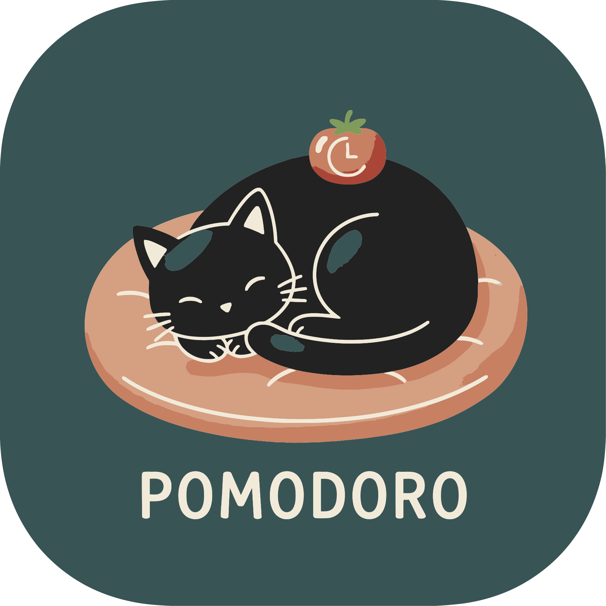
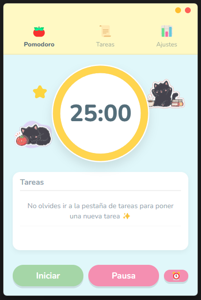
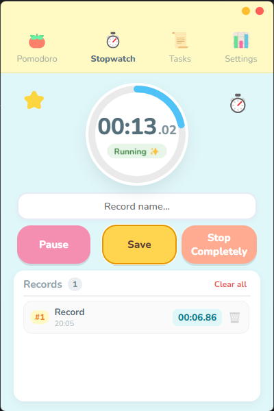
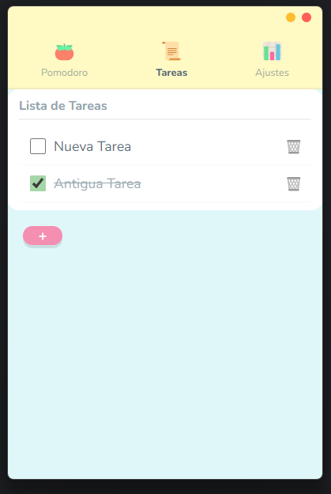
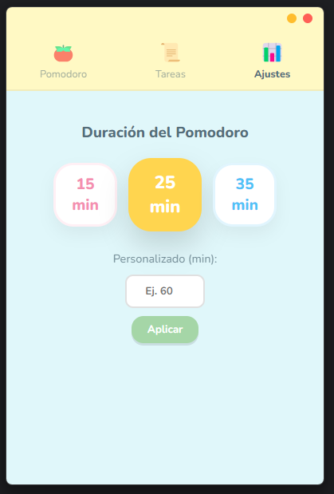

# Cute Pomodoro 🍅

A super cute, pastel-themed Pomodoro timer application built with Electron. Inspired by soft, friendly aesthetics to make productivity a little more delightful.

<p align="center">
    
</p>

## Features ✨

- **Pastel Aesthetic**: Soft colors, rounded UI, and cute interactions.
  - **Cute Companions**: Adorable animated cats (GatoPomodoro & GatoLibro) to keep you company while you focus.
- **Enhanced Pomodoro Timer**:
  - **Presets & Custom**: Choose from 15, 25, 35 minutes or set your own time.
  - **Visual Urgency**: The progress ring turns to a soft red when less than 10% of time remains.
  - **Quick Add**: Easily add +5 minutes with a fun floating animation.
- **Stopwatch / Cronómetro ⏱️**:
  - **Precision Timing**: Stopwatch tracking minutes, seconds, and centiseconds with a smooth circular 60-second progress ring.
  - **Named Time Records**: Pause or record laps anytime and assign custom labels/names to each record, with friendly auto-naming defaults.
  - **Flexible Controls**: Start, pause, resume, save records on the fly, or stop completely and reset back to zero.
  - **Records History**: Dedicated card displaying chronological entries with custom titles, timestamps, styled time badges, and individual or bulk delete actions.
  - **Persistent Storage**: All saved stopwatch records persist across restarts in `config.json`.
- **Task Management**:
  - Integrated To-Do list.
  - **Focus Mode**: Sees only the top 2 incomplete tasks on the timer screen to reduce overwhelm.
- **Productivity Features**:
  - **Floating Widget**: Enable a mini-timer widget in settings to keep track of time while working in other apps.
  - **Custom Alarm**: Upload your own audio file for the timer completion sound.
- **Completion Alerts**:
  - Window restores and shakes when the timer ends.
  - Plays your chosen alarm sound.
- **Multi-Language Support**:
  - Fully translated interface in **English** and **Spanish**.
  - Visual language switcher with cute circular flags in settings.
- **Data Persistence**:
  - **Auto-Save Settings**: Remembers your language preference and widget settings automatically (saved to `config.json`).
  - **Persistent Tasks & Records**: Tasks and stopwatch records survive restarts and are saved instantly!
- **Custom Window**:
  - Frameless design with custom, colored window controls.
  - **Robust Performance**: Optimized resource usage and reliable closure logic.
  - Single-instance lock (bringing the existing window to front if you try to open it again).

## Interface 📸

| Pomodoro Timer | Stopwatch | Tasks | Settings |
|:---:|:---:|:---:|:---:|
|  |  |  |  |

## Installation 🛠️

1.  **Clone the repository**:
    ```bash
    git clone https://github.com/yourusername/cute-pomodoro.git
    cd cute-pomodoro
    ```

2.  **Install dependencies**:
    ```bash
    npm install
    ```

## Running Locally 🏃‍♀️

To start the application in development mode:

```bash
npm start
```

## Building 🏗️

To create an executable for your OS (Windows .exe or Mac .dmg):

```bash
npm run build
```

This will generate the installers in the `dist/` folder.

## Technologies 💻

- **Electron**: Framework for cross-platform desktop apps.
- **HTML/CSS/JS**: Vanilla web technologies for the UI.
- **Electron Builder**: For packaging the application.

## Author 👤

Created with ❤️ by Crow6093.
